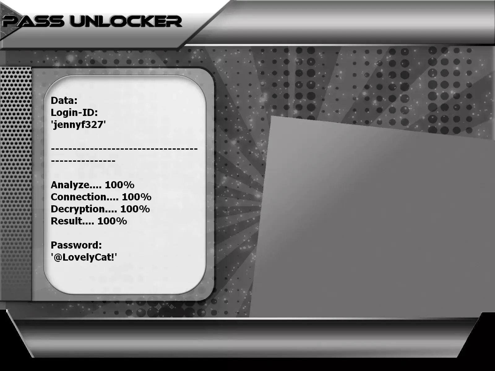

# 🔐 Hack TikTok Account 2026 — AI-Powered Hacker & Cracker Tool | Educational Use Only

**Machine-learning credential auditor for TikTok — training labs, research, and owned accounts only.**


> **Keywords:** hack TikTok account, TikTok hacker, cracker password, AI password cracking, ethical hacking, TikTok security audit, cybersecurity 2026

---

## ⚠️ Legal Notice — Read Before Use

**This GitHub repository is limited to EDUCATION, RESEARCH, and AUTHORIZED SECURITY TESTING.**

Attempting to **hack**, **crack**, or break into a TikTok profile you do not own — without written consent — is a **criminal offense**. By running this software, you agree to lawful, responsible use only.

- 🚫 **Unauthorized use forbidden**: Accessing third-party TikTok accounts without permission is illegal
- ✅ **Authorization required**: Test only profiles you created or lab environments covered by a signed audit letter
- 🔐 **Educational purpose**: Illustrate credential flaws and promote strong authentication
- ⚖️ **User liability**: You alone must comply with applicable laws and regulations

Inspired by responsible security research — provided **strictly** for educational use.

**Built with the PASS REVELATOR API.** To learn more about TikTok account protection and **password-hacking** techniques, visit:  
**[https://www.passwordrevelator.net/en/passunlocker](https://www.passwordrevelator.net/en/passunlocker)**



---

## 🧭 What Is This Tool?

The **TikTok AI Security Tester** is a Python framework showing how modern **crackers** blend machine learning with classic guessing — and how **ethical hackers** turn those insights into stronger defenses.

Every workflow targets simulation and reporting on accounts you control — never random third-party profiles.

---

## 🎓 Skills You Will Build

| Goal | Outcome |
| ---- | ------- |
| AI-assisted **password cracking** | Observe Markov chains, LSTM models, RL, and context scoring in a lab |
| Weak-credential awareness | See why predictable passphrases fail instantly |
| Professional training | Deliver a repeatable audit playbook to security teams |
| Defense research | Study countermeasures against automated bots |
| Policy design | Justify strict password rules with live metrics |

---

## ✨ Built-In Modules

### 🤖 Artificial Intelligence Engine

| Component | Role |
| --------- | ---- |
| **Markov chains** | Generate statistically likely candidates |
| **LSTM networks** | Predict sequences from known leak patterns |
| **Reinforcement learning** | Refine strategy based on live feedback |
| **Pattern detection** | Flag recurring user habits |
| **Context scoring** | Prioritize candidates tied to username or bio |

### 🌐 Anonymity Layer

- Full **Tor** network routing
- Proxy rotation to avoid IP blocks
- Request throttling to reduce detection
- User-Agent randomization
- Randomized delays between attempts
- Advanced session and cookie handling

### 📊 Analytics & Reporting

- Live attempt counters
- Throughput and success-rate metrics
- Structured JSON report export
- Verbose operation logging

### ⚡ Performance

- Async architecture for high concurrency
- Memory-efficient candidate generation
- Multi-thread worker pools
- Optimized HTTP request batching

---

## 🚀 Installation

### Prerequisites

- Python **3.8+**
- `pip` package manager
- Stable Internet connection
- TikTok developer account (authorized labs) + **personal test profile**

### Step 1 — Clone the Repository

```bash
git clone https://github.com/HoffmannAlex/Hack-TikTok-Account-with-AI.git
cd tiktok-security-tester
```

### Step 2 — Virtual Environment (Recommended)

```bash
# Windows
python -m venv venv
.\venv\Scripts\activate

# macOS / Linux
python3 -m venv venv
source venv/bin/activate
```

### Step 3 — Install Dependencies

```bash
pip install -r requirements.txt
```

**Core libraries:**

- `aiohttp>=3.9.1`
- `requests>=2.31.0`
- `cryptography>=42.0.5`
- `psutil>=5.9.8`
- `python-dotenv>=1.0.1`
- `msal>=1.24.1`
- `markovify>=0.9.4`
- `numpy>=1.24.3`
- `python-jose>=3.3.0`

### Step 4 — TikTok API Setup

Create `tiktok_config.json` at the project root:

```json
{
    "client_key": "YOUR_TIKTOK_CLIENT_KEY",
    "client_secret": "YOUR_TIKTOK_CLIENT_SECRET",
    "redirect_uri": "https://your-callback-url.com/callback",
    "api_base_url": "https://open-api.tiktok.com/",
    "auth_url": "https://www.tiktok.com/auth/authorize/",
    "token_url": "https://open-api.tiktok.com/oauth/access_token/"
}
```

### Step 5 — Verify Setup

```bash
python tiktok_security_tester.py --help
```

---

## ⚡ Quick Start (Authorized Accounts Only)

**Standard run**

```bash
python tiktok_security_tester.py --username my_test_account
python tiktok_security_tester.py --username my_test_account --config custom_config.json
```

**Anonymous lab session**

```bash
python tiktok_security_tester.py --username my_test_account --use-tor
python tiktok_security_tester.py --username my_test_account --proxy-list proxies.txt
```

**Performance tuning**

```bash
python tiktok_security_tester.py --username my_test_account --max-attempts 500
python tiktok_security_tester.py --username my_test_account --min-delay 2.0 --max-delay 5.0
python tiktok_security_tester.py --username my_test_account --verbose
```

**Results management**

```bash
python tiktok_security_tester.py --username my_test_account --output results/audit_2026.json
python tiktok_security_tester.py --resume results/audit_2026.json
```

> ⚠️ Replace `my_test_account` with a profile **you control**.

---

## 📝 Advanced Configuration

### OAuth `config.json`

```json
{
    "client_key": "YOUR_TIKTOK_CLIENT_KEY",
    "client_secret": "YOUR_TIKTOK_CLIENT_SECRET",
    "redirect_uri": "https://your-callback-url.com/callback",
    "api_base_url": "https://open-api.tiktok.com/",
    "auth_url": "https://www.tiktok.com/auth/authorize/",
    "token_url": "https://open-api.tiktok.com/oauth/access_token/"
}
```

### Environment Variables

```bash
export TIKTOK_USERNAME=my_test_account
export TIKTOK_MAX_ATTEMPTS=1000
export TIKTOK_USE_TOR=true
python tiktok_security_tester.py
```

---

## ❓ FAQ — Hack, Crack, or Break Into TikTok?

**Hacker vs cracker — what's the difference?**  
Hackers study systems to secure them. Crackers break in without permission. This repo serves the first group.

**Can I legally hack my own TikTok?**  
Yes — on accounts you created or lab profiles with written consent. Hacking someone else's profile is a crime.

**How does AI help a cracker?**  
Markov models, LSTM networks, and context scoring prioritize likely candidates faster than blind brute force — which is why you should audit **your own** passwords in a lab.

**Will this hack any TikTok account?**  
No. Strong unique passwords, 2FA, and login alerts block most classic attacks. The goal is **prevention**, not exploitation.

---

## 🔧 Troubleshooting

| Issue | Fix |
| ----- | --- |
| **Connection errors** | Check Internet; verify proxy or Tor settings |
| **Rate limiting** | Increase `--min-delay` / `--max-delay`; try `--use-tor` |
| **Authentication errors** | Confirm username and audit authorization |

**Debug logging** (default file: `tiktok_security_test.log`):

```bash
python tiktok_security_tester.py --username my_test_account --log-level DEBUG
```

---

## ⚖️ Legal & Ethical Guidelines

1. **Authorization** — Only test accounts you own or have explicit written permission to audit
2. **Compliance** — Follow cybersecurity and data-protection laws in your jurisdiction
3. **Responsibility** — You alone bear consequences of misuse
4. **Data hygiene** — Never store recovered credentials in plain text

By using this tool, you acknowledge that unauthorized access is illegal and results must only improve security of tested systems.

---

## 📜 License

Distributed under the **MIT License**. See the [LICENSE](LICENSE) file.

---

## 🙏 Acknowledgments

- Project contributors and open-source maintainers
- Security researchers promoting responsible disclosure

## 🤝 Contributing

Issues and pull requests welcome on GitHub.

## 📧 Contact

Open an issue for questions or support.

> ⭐ Star the repository if this framework helped your security learning!
